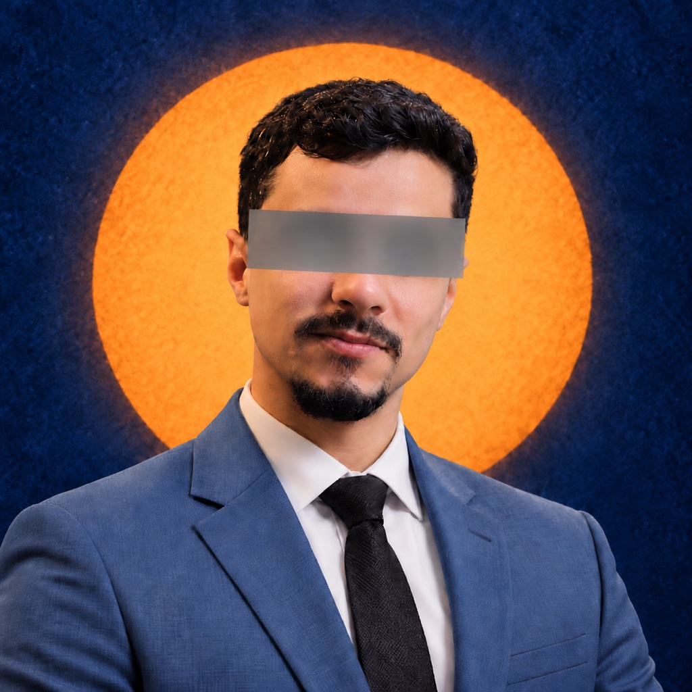
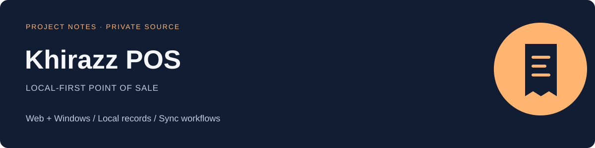

# Mohamed Bay

**Software development · networks · practical business systems**

This is my secondary development account. My main public account is **[@mohamedkbay](https://github.com/mohamedkbay)**.

I build Arabic-first applications and business tools, and work across development, infrastructure and technical problem-solving.

حسابي الثاني للشغل والتطوير. هنا نعرض فكرة بعض المشاريع ودوري فيها؛ السورس والبيانات التشغيلية يبقوا برايفت.

[Main profile](https://github.com/mohamedkbay) · [Full portfolio](https://github.com/mohamedkbay/portfolio) · [Personal website](https://mohamedbay.ly)

 

## Selected project notes

### الخراز · Khirazz POS

Point of sale for the web and Windows, with local-first records and optional synchronization. **My role:** application development and technical implementation.

[Read the overview →](projects/khirazz.md)

### SouqFlow POS

A Windows point-of-sale workspace for sales, inventory, customers and reports. **My role:** development and customization of the application workflows.

[Read the overview →](projects/souqflow.md)

### IDC Clinic Manager

Clinic administration for patient, appointment and team workflows. **My role:** application development and workflow implementation.

[Read the overview →](projects/idc-clinic-manager.md)

The images above are editorial project covers, not screenshots of customer systems. Project notes describe scope; they do not claim a public launch or independent production validation.

## Public work, private implementation

The application repositories remain private. This profile repository contains presentation material only: project notes, original covers and a profile portrait. It contains no application source code, deployment configuration, customer records or credentials.

The main [portfolio](https://github.com/mohamedkbay/portfolio) also covers UpDent, Glory Platform, Fakkerni, Masajiduna, Nabda and Fawtara.
