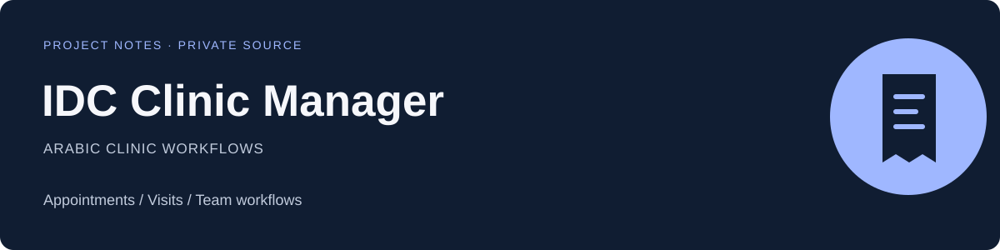

# IDC Clinic Manager

**An Arabic clinic administration workspace.**

[Back to this account](../README.md) · [Main portfolio](https://github.com/mohamedkbay/portfolio)

## The product

منظومة لإدارة العيادة، تشمل سير عمل المرضى والزيارات والمواعيد والأطباء والموظفين، مع واجهات للوصفات والفحوصات والتقارير.

The application brings clinic administration tasks into a shared Arabic interface.

## My work

Application development and implementation of clinic workflows, including records, scheduling, team roles and reporting interfaces.

## Workflows

- Patient administration and visit records.
- Appointments and scheduling.
- Doctor and staff workflows.
- Prescription, laboratory and reporting interfaces.

## Technology

React · TypeScript · Vite · Tailwind CSS

## Public scope

This page shows product scope and an original editorial cover only. The application source, access rules, configuration and all patient or staff records stay private. No live clinic screenshots, clinical records or account credentials are published.
