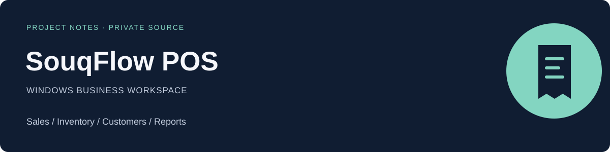

# SouqFlow POS

**Sales, stock and customer workflows in a Windows-focused application.**

[Back to this account](../README.md) · [Main portfolio](https://github.com/mohamedkbay/portfolio)

## The product

The project brings point-of-sale tasks and the surrounding business records into a Windows-oriented workspace.

## My work

Application development and customization of sales, stock, customer and reporting workflows. This page describes the product scope without publishing the implementation.

## Workflows

- Point-of-sale and sales operations.
- Product and inventory management.
- Customer records and transaction follow-up.
- Business reports and analysis views.

## Technology

TypeScript · web application interfaces · Windows desktop workflows

## Public scope

The source code, business records, access settings and deployment material remain private. The cover is an original editorial graphic, not a screenshot of a shop or customer account. No sales figures or customer identities are shown.
